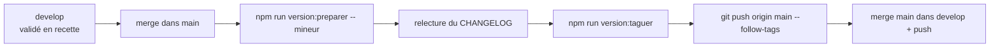

# 10 — Versionnement de l'application

## 1. Principe

- **Référence unique** : le champ `version` de `package.json`.
- **Une mise en production = une version** : chaque promotion `develop → main`
  (ou fusion d'un `hotfix/*`) porte un numéro de version, un **tag git**
  `vX.Y.Z` posé sur `main` et une section dans [`CHANGELOG.md`](../../CHANGELOG.md).
- **Pas de Release GitHub** : tags + CHANGELOG suffisent (décision du
  2026-11-04). Elles pourront être ajoutées plus tard si l'on veut diffuser les
  guides PDF ou annoncer les nouveautés.
- Point de départ : **`1.0.0`** = première mise en production après l'adoption
  de cette convention (2026-11-04), obtenue par `version:preparer -- majeur`
  depuis `0.1.0`. Pas de rattrapage des mises en prod antérieures.

## 2. Numérotation — SemVer adapté

`MAJEUR.MINEUR.CORRECTIF` :

| Incrément | Quand | Exemple |
|-----------|-------|---------|
| **MAJEUR** | Rupture pour les utilisateurs : nouvelle saison / nouveau règlement, rôle supprimé, migration non rétrocompatible | `1.4.2 → 2.0.0` |
| **MINEUR** | Nouvelle fonctionnalité ou évolution de spec (nouvelles règles Rn) | `1.4.2 → 1.5.0` |
| **CORRECTIF** | Correction de bug sans changement de spec | `1.4.2 → 1.4.3` |

Une version qui mélange plusieurs types prend l'incrément le plus fort.

## 3. CHANGELOG

[`CHANGELOG.md`](../../CHANGELOG.md) à la racine, en français, format
[Keep a Changelog](https://keepachangelog.com/fr/1.1.0/), version la plus récente
en tête. Chaque version :

```text
## [1.5.0] — 2026-11-20

### Ajouté
- Modification des éléments de structure d'une rencontre (spec #3 R51–R55).

### Corrigé
- …

### Migrations à appliquer
- `202611151000_…` (cf. supabase/migrations/JOURNAL.md)
```

- Sections possibles : **Ajouté**, **Modifié**, **Corrigé**, **Supprimé**,
  **Migrations à appliquer**. On omet les sections vides.
- Chaque entrée renvoie à la **spec et aux règles** concernées quand il y en a.
- Écrit pour un lecteur fonctionnel : les commits `docs`, `test`, `refactor`,
  `chore` sans effet visible n'y figurent pas.
- La section **Migrations à appliquer** fait le lien code ↔ schéma : une version
  ne part en prod qu'une fois ces migrations appliquées en prod
  (cf. [03-base-de-donnees-supabase.md](./03-base-de-donnees-supabase.md) §5).

## 4. Procédure de mise en production



Skill associé : `publier-version` (`.claude/skills/publier-version/`).

1. Sur `main`, fusionner `develop` (ou le `hotfix/*`), arbre propre.
2. `npm run version:preparer -- <majeur|mineur|correctif>` :
   - incrémente `version` dans `package.json` (et `package-lock.json`) ;
   - insère en tête du CHANGELOG un **brouillon** de section, construit à partir
     des commits `feat` / `fix` depuis le dernier tag et des migrations ajoutées
     dans `supabase/migrations/` depuis ce tag.
3. **Relire et réécrire** le brouillon (langage utilisateur, regroupement, specs).
4. `npm run version:taguer` : vérifie que la version a une section dans le
   CHANGELOG, commite `chore(release): vX.Y.Z` puis pose le tag annoté `vX.Y.Z`.
5. `git push origin main --follow-tags` (= déploiement prod), puis fusionner
   `main` dans `develop` et pousser, pour que `develop` reparte de la nouvelle
   version.

Le push reste **manuel** (règle « committer/pousser uniquement sur demande »,
cf. [05-git-et-deploiement.md](./05-git-et-deploiement.md) §3).

## 5. Version exposée

### Dans l'application

La version est injectée **au build** et publiée dans une balise meta du
`<head>`, **invisible à l'écran** (visible dans le code source de la page) :

```html
<meta name="version" content="1.5.0+abc1234">
```

| Environnement | Format | Exemple |
|---------------|--------|---------|
| Production (`main`) | `X.Y.Z+<commit>` | `1.5.0+abc1234` |
| Recette / preview (autre branche) | `X.Y.Z-<branche>+<commit>` | `1.5.0-develop+abc1234`, `1.5.0-feature-classement+9f8e7d6` |
| Local (pas d'info de déploiement) | `X.Y.Z-local` | `1.5.0-local` |

- `<commit>` = 7 premiers caractères du SHA. Sources : Netlify (`CONTEXT`,
  `BRANCH`, `COMMIT_REF`) ou Vercel (`VERCEL_ENV`, `VERCEL_GIT_COMMIT_REF`,
  `VERCEL_GIT_COMMIT_SHA`).
- Le nom de branche est normalisé (minuscules, tout caractère hors `a-z0-9` →
  `-`).
- Logique : `src/lib/version.ts` (testée), lue par `next.config.ts`, publiée par
  `src/app/layout.tsx`.

**Cahier de test** : relever cette balise au début d'une campagne et la noter
dans l'en-tête de l'exécution (version testée).

### Dans les guides utilisateur

Les PDF générés par `npm run doc:pdf` affichent la version de `package.json`
sous le titre (« Édition du … — version X.Y.Z ») et en pied de page. Les
régénérer après chaque mise en production pour que la version diffusée
corresponde.

## 6. À ADAPTER pour un autre projet

- Les variables de déploiement si l'hébergeur n'est pas Vercel.
- La version de départ et la date de la décision.
