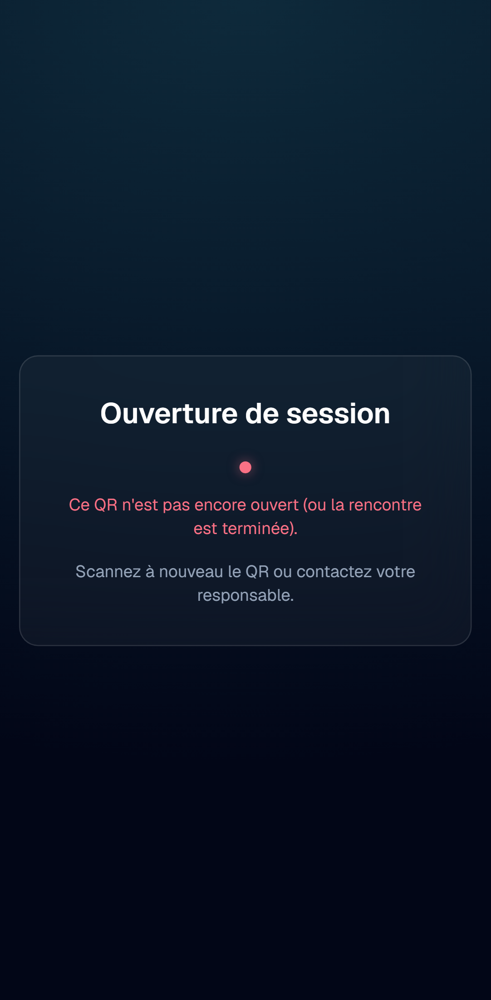
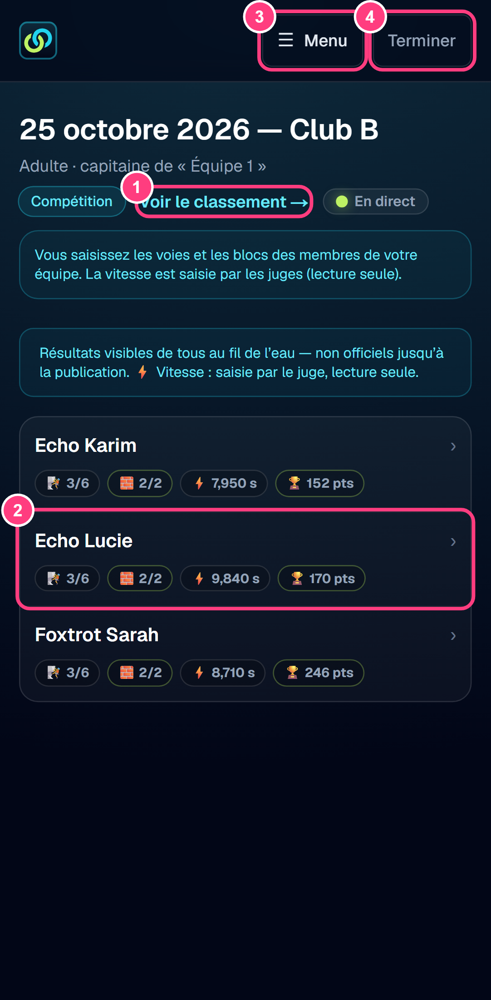
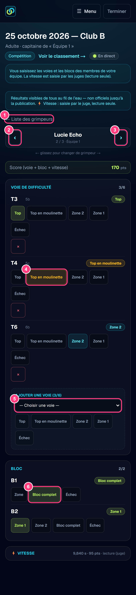
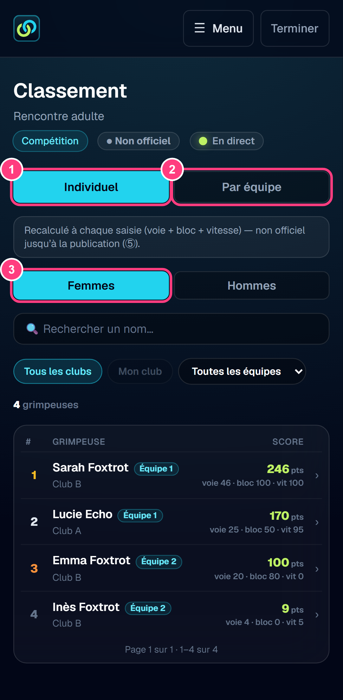

# Guide utilisateur — Capitaine d'équipe (rencontre adulte)

> **Public** : capitaines d'équipe lors d'une rencontre **adulte** (accès par QR
> le jour de la rencontre, sans compte).
>
> **Captures** : générées automatiquement au format téléphone par
> `npm run doc:captures` (voir [Mettre à jour les captures](#mettre-à-jour-les-captures)).
> Les numéros roses sur les captures renvoient à la colonne « N° » des tableaux.

## Sommaire

1. [Avant de commencer](#1-avant-de-commencer)
2. [Ouvrir la session](#2-ouvrir-la-session)
3. [Votre équipe](#3-votre-équipe)
4. [Saisir les résultats d'un grimpeur](#4-saisir-les-résultats-dun-grimpeur)
5. [Consulter le classement](#5-consulter-le-classement)
6. [Fin de session](#6-fin-de-session)
7. [Questions fréquentes](#7-questions-fréquentes)

## 1. Avant de commencer

Dans une rencontre adulte, les équipes sont composées par l'**organisateur** :
4 grimpeurs au plus, de clubs différents. Chaque équipe a un **capitaine** qui
saisit, sur son téléphone, les résultats de **voie** et de **bloc** des membres
de son équipe. Il n'a pas de compte : il utilise le **QR code de son équipe**,
remis par l'organisateur. L'application s'utilise dans le navigateur du
téléphone ; il n'y a rien à installer.

| Ce que fait le capitaine | Ce qu'il ne fait pas |
| --- | --- |
| Saisir et corriger les voies et les blocs de son équipe | Saisir pour une autre équipe |
| Consulter les scores et le classement | Saisir la vitesse (réservée aux juges) |
| | Modifier la composition de l'équipe (organisateur) |

Selon les personnes présentes, l'organisateur peut **désactiver** l'épreuve de
bloc ou de vitesse : elle n'apparaît alors nulle part et ne compte pas dans le
score.

## 2. Ouvrir la session

Scannez le QR de votre équipe avec l'appareil photo du téléphone **pendant la
compétition** : vous arrivez sur l'écran de votre équipe.

Avant le début de la compétition (ou après sa fin), le QR n'ouvre pas de
session :

| Message | Que faire |
| --- | --- |
| « Ce QR n'est pas encore ouvert (ou la rencontre est terminée). » | Attendre que l'organisateur lance la compétition, puis rescanner |
| « Ce QR a été révoqué. » | Demander le nouveau QR à l'organisateur |
| « Ce QR n'est pas reconnu. » | Vérifier que le bon QR a été scanné |

## 3. Votre équipe

| N° | Élément | Effet |
| --- | --- | --- |
| 1 | Voir le classement | Ouvre le classement de la rencontre |
| 2 | Ligne d'un grimpeur | Ouvre sa fiche de saisie |
| 3 | Menu | Navigation : « Mon équipe », « Classement » |
| 4 | Terminer | Ferme la session sur le téléphone |

Les membres de l'équipe sont listés par ordre alphabétique (nom puis prénom).
Chaque ligne résume la progression du grimpeur :

| Pastille | Signification |
| --- | --- |
| 🧗 `2/6` | Voies de difficulté saisies (6 au plus) |
| 🧱 `1/2` | Blocs saisis |
| ⚡ | Vitesse : temps, chute, non présenté, ou « en attente » du juge |
| 🏆 | Score actuel, non officiel |

Une pastille disparaît quand son épreuve est désactivée par l'organisateur.

## 4. Saisir les résultats d'un grimpeur

| N° | Élément | Effet |
| --- | --- | --- |
| 1 | ← Liste des grimpeurs | Retour à l'équipe |
| 2 | ‹ (Grimpeur précédent) | Passe au membre précédent (ou glisser vers la droite) |
| 3 | › (Grimpeur suivant) | Passe au membre suivant (ou glisser vers la gauche) |
| 4 | Issue d'une voie | Top, Top en moulinette, Zone 2, Zone 1 ou Échec |
| 5 | Choisir une voie | Ajoute une nouvelle voie au grimpeur |
| 6 | Issue d'un bloc | Palier atteint ou Échec |

**Voies** : le grimpeur choisit librement **jusqu'à 6 voies**. Choisir la voie
dans la liste, puis l'issue :

| Issue | Points |
| --- | --- |
| **Top** (en tête) | Points du top de la voie |
| **Top en moulinette** | Moitié du top, arrondie au-dessus (pastille ambre) |
| **Zone 2** / **Zone 1** | Points de la zone atteinte |
| **Échec** | 0 |

Une voie grimpée en moulinette sans aller au top est un **Échec** : les zones ne
comptent pas en moulinette. Une 7ᵉ voie est refusée.

**Blocs** : toucher le palier atteint (« Zone », « Bloc complet »…) ou
**Échec**.

**Corriger** : toucher la bonne issue, elle remplace la précédente ; une voie
saisie par erreur peut être retirée. On saisit toujours la **meilleure
tentative**.

**Vitesse** : saisie par les juges, affichée en lecture seule.

**Score** : le bandeau « Score » se met à jour à chaque saisie.

**Réseau faible ou coupé** : continuez à saisir. Les saisies sont gardées sur le
téléphone et envoyées dès le retour du réseau ; un bandeau indique le nombre de
saisies en attente. Ne fermez pas la page tant qu'il en reste.

## 5. Consulter le classement

| N° | Élément | Effet |
| --- | --- | --- |
| 1 | Individuel | Classement individuel, avec le club d'origine de chacun |
| 2 | Par équipe | Classement des équipes (somme des scores des membres) |
| 3 | Femmes / Hommes | Classement individuel de chaque sexe |

Le classement est recalculé à chaque saisie. Il n'est **officiel** qu'après sa
publication par l'organisateur. Il n'y a pas de classement par club en adulte.

## 6. Fin de session

- **Terminer** ferme la session sur le téléphone : à faire en fin de journée sur
  un téléphone prêté ou partagé.
- La session s'arrête aussi à la fin de la compétition, ou si l'organisateur
  révoque ou régénère le QR : il faut alors scanner le nouveau QR.

## 7. Questions fréquentes

**« Rescannez le QR code de votre équipe »**
La session a pris fin (QR révoqué ou compétition terminée). Demandez le QR à
jour à l'organisateur.

**Un membre manque dans la liste.**
Seul l'organisateur compose les équipes ; signalez-lui l'oubli.

**Je ne vois pas les blocs (ou la vitesse).**
L'organisateur a désactivé l'épreuve pour cette rencontre : il n'y a rien à
saisir.

**Une saisie est refusée.**
Lisez le motif affiché (par exemple, 7ᵉ voie) ; l'organisateur peut corriger si
besoin.

**Je me suis trompé après la fin de la compétition.**
Signalez l'erreur à l'organisateur : lui seul peut corriger un résultat après
la clôture.

## Mettre à jour les captures

Les captures sont produites par `scripts/captures/guide-capitaine.captures.ts`
(Playwright, format Pixel 7) à partir du jeu de données de test :

1. Stack Supabase locale démarrée avec le seed (`npm run db:reset`).
2. `npm run doc:captures` (lance l'application sur le port 3011 si besoin).
3. La rencontre adulte de démonstration (`supabase/seed/05-demo-adulte.sql`) est
   chargée au début et supprimée à la fin ; les PNG de
   `docs/guides/capitaine/captures/` sont réécrits.
