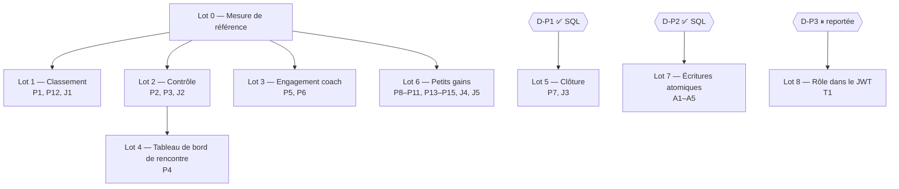

# Plan d'action — appels Supabase par écran et par action (2026-10-09)

Plan de traitement des constats de
[l'analyse du 2026-10-09](./2026-10-09-analyse-appels-supabase.md). Objectif :
**réduire le nombre de vagues séquentielles** par écran et par action, et
**corriger les lectures tronquées** (J1–J5).

Complété le 2026-11-10 par
[l'analyse des traitements côté base](./2026-11-10-analyse-traitements-base.md)
(constats B1–B4, R1–R5, L1–L4, E1–E6 ; lots 9 à 12).

Statuts : ✅ fait · 🔄 en cours · ⏳ en attente (à faire) · ❓ décision requise ·
🚫 bloqué (dépendance non levée) · ⏸ reporté

Dernière mise à jour : 2026-11-10.

## Principes

- **Modèle de référence** : `chargerSaisie` (`src/lib/coach/resultats.ts`), qui
  fait une seule vague, filtre chaque table sur la rencontre par jointure
  `!inner`, embarque les noms (`grimpeur:grimpeur_id(nom, prenom, club:club_id(nom))`)
  et pagine avec `lireToutesLesPages`.
- **Pas de changement de comportement** dans les lots 1 à 6 : mêmes données,
  même affichage. Les specs ne changent pas. Les E2E existants sont le filet de
  sécurité ; chaque lot doit les garder au vert.
- **J1/J2 sont des corrections**, qui rendent le code conforme aux specs #7 et
  #16. Elles se prouvent par un test qui échoue **avant** la correction (rouge),
  au-delà de 1000 lignes.
- **Les lots 7 et 8 touchent la base ou une spec** : validation explicite
  d'abord (règle de changement), puis spec → tests → code, migration validée sur
  la stack locale et appliquée **à la main** en recette.
- Toute lecture passe par `verifierLecture` (convention 02 §7) ; toute lecture
  qui peut dépasser 1000 lignes est paginée.
- **Une branche par lot** (`feature/perf-…`), fusionnée dans `develop`.

## Décisions

| # | Question | Recommandation | Constats | Lot | Spec touchée |
| --- | --- | --- | --- | --- | --- |
| D-P1 | Clôture : refactoring TypeScript (~5 vagues) ou RPC SQL transactionnelle « changement de phase + NP » (1 appel, atomique) ? | ✅ **Fonction SQL** (2026-10-09) — règle aussi le point laissé ouvert au lot 2 de la revue du 2026-10-03 | P7, J3 | 5 | aucune (migration) |
| D-P2 | Écritures en plusieurs étapes : une RPC par opération ? | ✅ **Fonction SQL** par opération (2026-10-09) : atomicité + 1 appel | A1–A5 | 7 | aucune (migrations) |
| D-P3 | Rôle et club dans le JWT (Custom Access Token Hook) pour supprimer la vague 0 ? | ⏸ **Reportée** (2026-10-09) : à reconsidérer après les lots 0–3 et une décision sur la région d'hébergement ; si reprise, option « délai court inscrit dans la spec » | T1 | 8 | #1, #2, ADR 0005 |

## Ordre des lots



## Tableau de suivi

| Lot | Constats | Vagues avant → cible | Branche | Statut |
| --- | --- | --- | --- | --- |
| 0 | — | — | `feature/perf-mesure` | ✅ |
| 1 | P1, P12, J1 | classement 8 → 2 | `feature/perf-classement` | ✅ |
| 2 | P2, P3, J2 | contrôle 8 → 2 ; coche 6 → 3 | `feature/perf-controle` | ✅ |
| 3 | P5, P6 | engagement 5 → 2 ; actions −1 | `feature/perf-engagement-coach` | ✅ |
| 4 | P4 | 7 → 2–3 (④/⑤) | `feature/perf-tdb-rencontre` | ✅ |
| 5 | P7, J3, B2 | ≤ 10 → 2 (RPC) | `feature/perf-cloture` | ✅ |
| 6 | P8–P11, P13–P15, J4, J5 (L4) | −1 vague par écran ou action | `feature/perf-petits-gains` | 🔄 (J4 fait) |
| 7 | A1–A5, P15 (E6) | 3–5 → 2 | `feature/rpc-ecritures-atomiques` | ✅ |
| 8 | T1 | −1 sur **toutes** les requêtes | — | ⏸ reportée |
| 9 | B1, B3, B4 (= J5) | correctifs | `feature/correctifs-lectures` | ✅ |
| 10 | R1, R3, R4, R5 (R2 reporté) | relectures temps réel ÷ ~100 par temps de vitesse | `feature/perf-temps-reel` | ✅ |
| 11 | E1–E5 | gardes ajoutées en base ; ajouts de structure 3 → 2 | `feature/gardes-en-base` | ✅ |
| 12 | L1, L2 ; L3 après mesure | classement et saisie 11 → 6 requêtes | `feature/perf-lectures-imbriquees` | ✅ (L3 reporté) |

Ordre recommandé (2026-11-10) : 9 → 10 (R1 d'abord) → 5 → 12 → 11 → 7 → 6.

Décisions du 2026-11-10 : les gardes TypeScript sont **conservées** (on ajoute
celles qui manquent en base) ; le calcul du classement **reste en TypeScript**.

## Lot 0 — Mesure de référence — ✅

Rendre le nombre d'appels et de vagues **observable** : c'est ce qui permettra
de vérifier chaque lot.

- [x] ✅ Traçage optionnel des appels Supabase côté serveur
  (`src/lib/supabase/trace.ts`, testé dans `trace.test.ts`) : `fetch`
  personnalisé (`global.fetch`) dans `createClient` et `createAdminClient`,
  activé par `SUPABASE_TRACE=1`. Une ligne par appel (séquence, vague, rang,
  décalage, durée, statut, table ou RPC), puis un résumé par séquence. Inactif
  par défaut, jamais en production (`NODE_ENV=production`).
- [x] ✅ Référence relevée en local le 2026-10-10 (base au seed) : voir
  « Mesures » ci-dessous.
- [x] ✅ Typecheck, lint, Vitest, `lint:md`.

### Mode opératoire

1. Base locale au seed, puis `SUPABASE_TRACE=1 npm run dev` (un seul `next dev`
   par dossier : arrêter celui qui tourne).
2. Se connecter, attendre 1 s, puis ouvrir **un seul écran à la fois**, en
   laissant au moins 1 s entre deux écrans. Mesurer la **deuxième** visite (la
   première peut inclure la compilation de la route).
3. Lire les lignes `[supabase]` du terminal :

   ```text
   [supabase] #13 v2 a2 +7ms 6ms 200 GET rencontre
   [supabase] #13 terminée : 8 vagues, 16 appels, 113 ms
   ```

   `#13` est la séquence (une requête), `v2` la vague, `a2` le rang de l'appel.

Limites de l'heuristique : une vague est un ensemble d'appels lancés pendant que
d'autres sont en vol. Deux chaînes indépendantes lancées en parallèle (par
exemple les deux catégories du gabarit) peuvent donc se chevaucher et compter
moins de vagues que leur chemin critique. Une Server Action compte l'action, le
re-rendu (`revalidatePath`) et, le cas échéant, le rafraîchissement déclenché
par le temps réel, dans une même séquence ou dans la suivante.

## Lot 1 — Classement (P1, P12, J1) — ✅

Fichiers : `src/lib/classement/classement.ts`,
`src/lib/export/export-classement.ts`.

- [x] ✅ **Rouge (J1)** : `e2e/classement-volume.spec.ts` (cahier 18 CT-14) pose
  80 grimpeuses × 14 voies = 1120 résultats de voie. Sur l'ancien code,
  l'équipe affichait **7476 pts au lieu de 8400** : 120 résultats ignorés sans
  erreur.
- [x] ✅ Réécrire `getClassementRencontre` en **une vague** : rencontre,
  épreuves, voies et blocs via `epreuve!inner(rencontre_id)`, paliers via
  `bloc!inner(epreuve!inner(...))`, équipes avec `club:club_id(nom)`,
  compositions (paginées) avec `grimpeur:grimpeur_id(nom, prenom, sexe, club_id, club:club_id(nom))`,
  `resultat_voie` / `resultat_bloc` (paginés, filtrés par jointure sur la
  rencontre), `points_vitesse` / `temps_vitesse` (filtrés par jointure sur
  l'épreuve).
- [x] ✅ Sortie inchangée (types `ClassementRencontre`, décomposition R13,
  phases R10/R11) ; la phase est connue dans la même vague. Seul ajustement :
  la décomposition est désormais **triée par ordre des voies et des blocs**.
  Elle suivait auparavant l'ordre, non garanti, renvoyé par la base, et la spec
  ne fixe pas d'ordre.
- [x] ✅ P12 : les écrans de classement lisent `exportDisponible` en parallèle du
  classement. `reponseExportPdf` lance la lecture du classement en parallèle de
  la vérification d'accès, et ne l'utilise que si l'accès est accordé (refus →
  404, rien n'est lu pour un anonyme). Les cas d'accès du cahier 26 sont
  automatisés : `e2e/export-pdf.spec.ts`.
- [x] ✅ Vert : J1, `test:cahier:classement`, `test:cahier:vitesse`,
  `navigation-routing`, export PDF (cahier 26) ; suite E2E complète
  (169 tests, chromium, en série) et Vitest.
- [x] ✅ Mesure après : classement et affichage **2 vagues**, PDF **3 vagues**.
  Dans un route handler, `cache()` ne s'applique pas : `compte` y est relu par
  la garde du classement (vague de plus, à reprendre si le lot 8 est mené).

## Lot 2 — Contrôle (P2, P3, J2) — ✅

Fichiers : `src/lib/admin/controle.ts`, `src/lib/admin/controle-actions.ts`.

- [x] ✅ **Rouge (J2)** : `e2e/controle-volume.spec.ts` (cahier 27 CT-21), 1120
  résultats de voie. Sur l'ancien code, les voies affichaient **0/71 ou 0/72 au
  lieu de 0/80** (exactement 1000 lignes lues).
- [x] ✅ `getControleRencontre` en une vague : jointures `!inner` sur la
  rencontre, grimpeur et club embarqués dans les résultats, club d'accueil
  embarqué dans les compositions, résultats et compositions paginés. Toutes
  les lectures passent par `verifierLecture` (l'ancienne lecture `grimpeur`
  n'était pas vérifiée).
- [x] ✅ Auteurs du contrôle : **écart au plan**. `listUsers` n'est pas
  retenu, parce qu'il liste aussi les utilisateurs anonymes des sessions QR.
  Ces comptes ne sont jamais purgés et dépasseraient une page de 1000 au fil
  des saisons. Les `getUserById` (un par auteur distinct, quelques admins)
  restent, lancés en parallèle dans **une seule vague** après les données.
  Contrôle = 2 vagues sans coche, 3 avec.
- [x] ✅ P3 : `basculerControle` lit la phase en **une lecture embarquée**
  `resultat → voie/bloc → epreuve → rencontre(phase)`.
- [x] ✅ Vert : J2, E2E `admin-controle` (cahier 27), suite E2E complète.
- [x] ✅ Mesure après : contrôle 2 vagues (3 avec auteurs), coche 3.

## Lot 3 — Engagement coach (P5, P6) — ✅

Fichiers : `src/lib/coach/engagement.ts`, `src/lib/coach/actions.ts`.

- [x] ✅ `getEngagementRencontre` en **une vague**, variante retenue : la
  rencontre est lue avec le reste (avec son club porteur embarqué) et la
  fonction renvoie `null` si elle est absente. Les compositions embarquent le
  grimpeur et son club, les prêts le club d'origine. Toutes les lectures
  passent par `verifierLecture`.
- [x] ✅ Actions : `equipeDuClub` lit l'équipe **et** sa rencontre en une
  lecture (`rencontre:rencontre_id(phase, categorie, date_rencontre)`), soit
  une vague de moins sur renommer, supprimer, ajouter, retirer et groupe de
  départ.
- [x] ✅ `ajouterGrimpeurEquipe` : les contrôles (grimpeur, membres, engagés,
  prêt) partent dans la même vague que l'équipe. Engagés et prêt sont lus pour
  la rencontre du formulaire ; si elle diffère de celle de l'équipe (appel
  forgé), l'action répond « Équipe introuvable. ». Ces quatre lectures n'étaient
  pas vérifiées : elles passent désormais par `verifierLecture`.
- [x] ✅ Vert : `coach-engagement`, `integrite-engagement`,
  `temps-reel-engagement`, `securite-appels-directs`, `admin-prets`,
  `admin-equipes`, puis suite E2E complète et Vitest.
- [x] ✅ Mesure après : engagement 2 vagues ; ajout 3 ; retrait 3. Avec le
  re-rendu et l'écho temps réel, un clic d'ajout passe de 13 à 7 vagues.

## Lot 4 — Tableau de bord de rencontre admin (P4) — ✅

Fichier : `src/app/admin/rencontres/[id]/page.tsx` et ses loaders.

- [x] ✅ `getControleRencontre` remplacé par `getProgressionControle` : quatre
  **comptages** (`count: 'exact', head: true`, total et contrôlés, voies et
  blocs), lancés seulement en ④/⑤. Le domaine gagne `progressionDeComptes`,
  testé en Vitest et aligné sur `progressionGlobale` (R3). La progression ne
  peut plus être tronquée : vérifié au-delà de 1000 résultats
  (`e2e/controle-volume.spec.ts`). L'option `avecAuteurs` de
  `getControleRencontre`, devenue inutile, est retirée.
- [x] ✅ Lectures communes partagées via `cache()` dans
  `src/lib/rencontres/lectures-admin.ts` : rencontre (structure, prêts,
  équipes, contrôle), catalogue des clubs (prêts, équipes), prêts (prêts,
  équipes).
- [x] ✅ Vert : `admin-equipes`, `admin-prets`, `pilotage-phase`,
  `admin-controle`, `navigation-routing`, `integrite-engagement`, puis suite
  E2E complète et Vitest.
- [x] ✅ Mesure après : ①–③ 2 vagues / 13 appels (au lieu de 18) ; ④/⑤ 2
  vagues mesurées / 17 appels (au lieu de 27). Le chemin critique reste
  compte → rencontre → comptages et grimpeurs éligibles.

## Lot 5 — Clôture (P7, J3, B2) — ✅

D-P1 tranchée le 2026-10-09 : **fonction SQL**.

- [x] ✅ **Rouge (B2)** : `e2e/cloture-volume.spec.ts` (cahier 17 CT-19).
  80 grimpeuses (groupe M1) ont saisi M1, M2 et M3 sur une **seconde** voie du
  niveau, plus M4 et T1–T10 : 1120 résultats de voie. Sur l'ancien code, la
  clôture posait **80 NP de voie au lieu de 0** : les résultats au-delà de 1000
  étaient ignorés et le niveau passait pour « non saisi ».
- [x] ✅ **Rouge** : `scripts/test-cloture.sh` (`npm run test:cloture`), 29 KO
  sur 40 sans la RPC.
- [x] ✅ Migration `202611101300_rpc_changer_phase_rencontre` : RPC
  `changer_phase_rencontre(p_rencontre, p_phase)`, SECURITY DEFINER, dans une
  transaction : garde admin, verrou de la rencontre (`for update`), transition
  adjacente R17 (retour ③ → ① hors jour J), garde du jour J (spec #1 R5,
  `current_date`), mise à jour conditionnée à la phase lue, NP automatique R18
  en SQL (compositions et résultats lus par la base : plus de troncature,
  `resultat_bloc` filtré par rencontre). Un NP en échec annule le changement de
  phase. EXECUTE à `authenticated` seul ; retour arrière dans
  `supabase/retours-arriere/`.
- [x] ✅ `changerPhaseRencontre` garde ses contrôles TypeScript (messages clairs)
  et appelle la RPC : 1 appel d'écriture au lieu de 2 à 8. Les refus de la base
  (course entre deux admins, jour changé) reprennent les messages de l'écran.
  `src/lib/rencontres/cloture.ts` est retiré, ainsi que `manquantsCloture`
  (domaine), devenu inutile : R18 est testée par `test:cloture`.
- [x] ✅ Vert : `test:cloture` 40/40 (dont deux clôtures simultanées : une seule
  passe ; rejeu, retour arrière, réapplication), `db:verifier`,
  `db:verifier-retours`, E2E `cloture-volume`, `pilotage-phase`,
  `coach-saisie-resultats` (CT-12), `admin-controle`, suite E2E complète et
  Vitest.
- [x] ✅ Appliquée à la main en recette le 2026-11-10 (JOURNAL).
- [ ] ⏳ Cahier 17 CT-19 et CT-12 en recette ; prod avant la mise en prod.

## Lot 6 — Petits gains (P8–P11, P13–P15, J4, J5) — ⏳

- [ ] ⏳ P8 `/coach/jetons` : une seule lecture `jeton_qr`
  `.in('rencontre_id', ids)` (ou embarquée dans la lecture des rencontres).
- [ ] ⏳ P9 `listerGabarit` : une lecture imbriquée de `gabarit_epreuve` avec ses
  voies, blocs (avec paliers), voies de vitesse et échelons, pour les deux
  catégories en un appel.
- [ ] ⏳ P10 `/admin/jetons` : lancer `listerRencontres` et les sections de la
  rencontre en parallèle (l'id vient de l'URL).
- [ ] ⏳ P11 `getSaisieAdminRencontre` : nom du club embarqué dans la lecture des
  équipes de `chargerSaisie` (`club:club_id(nom)`).
- [ ] ⏳ P13 structure : la phase et le prochain ordre sont lus en parallèle.
- [ ] ⏳ P14 saisie admin bloc : le contexte du bloc et le palier sont lus en
  parallèle.
- [ ] ⏳ P15 `regenererJeton` : réutiliser la ligne lue par `jetonGerable`.
- [x] ✅ J4 compteurs (2026-11-10) : comptages faits par la base, sans
  migration. Totaux du tableau de bord admin en `count: 'exact', head: true`
  (et seules les 5 dernières rencontres lues) ; nombre de grimpeurs et de
  rencontres par club, d'équipes et d'épreuves par rencontre, d'équipes et de
  grimpeurs du club sur l'accueil coach en comptage embarqué
  (`grimpeur(count)`, `equipe(count)`, `equipe(composition(count))`, helper
  `src/lib/supabase/embarque.ts`). Liste des clubs, liste des rencontres et
  accueil coach passent à une seule requête. **Rouge** :
  `e2e/compteurs-volume.spec.ts` (1100 grimpeurs, 1100 équipes) ; sur l'ancien
  code, 980 grimpeurs et 996 équipes affichés.
- [x] ✅ J6 mapping des comptes (2026-11-10) : `listUsers` ne lisait qu'une
  page de 1000 utilisateurs, comptes anonymes des sessions QR compris (jamais
  purgés) ; au-delà, des comptes permanents disparaissaient de l'écran. RPC
  `lister_comptes_permanents` (migration `202611101000`) : anonymes exclus,
  mapping et club joints, en une requête. **Rouge** : `compteurs-volume` (1100
  anonymes) ; sur l'ancien code, `coach@test.local` absent de l'écran.
- [x] ✅ Rapport périodique (2026-11-10) : effectifs par club et année de
  naissance comptés en base (RPC `effectifs_grimpeurs`, migration
  `202611101100`) au lieu de lire tous les grimpeurs ; équipes par rencontre en
  comptage embarqué au lieu de lire toutes les équipes de la saison. Tests SQL :
  `npm run test:rpc-comptages`.
- [x] ✅ J5 prêts : chemin corrigé au lot 9 (B4).
- [ ] ⏳ Vert : E2E concernés (`admin-prets`, `navigation-routing`, jetons).

## Lot 7 — Écritures atomiques (A1–A5) — ✅

D-P2 tranchée le 2026-10-09 : **une fonction SQL par opération**. Branche
`feature/rpc-ecritures-atomiques` (2026-11-10), migration
`202611101600_rpc_ecritures_atomiques`. Aucune spec modifiée.

- [x] ✅ Migration : RPC `mettre_a_jour_bareme_vitesse` (rencontre) et
  `mettre_a_jour_bareme_vitesse_gabarit`, `regenerer_jeton`,
  `regenerer_invitation_coach`, `generer_invitation_admin`. **SECURITY
  INVOKER** : la RLS reste la frontière (admin ; coach pour le jeton de coach
  temporaire de son club), la transaction de l'appel donne l'atomicité. Garde
  `est_admin()` en tête des opérations admin ; R55e revérifiée en base ; phase
  du barème de rencontre gardée par le trigger du lot 11. EXECUTE à
  `authenticated` seul, `db:verifier` vert.
- [x] ✅ Rouge : `scripts/test-ecritures-atomiques.sh`
  (`npm run test:ecritures-atomiques`), 26 KO sur 39 sans la migration ; vert
  39/39 : succès, refus, atomicité (création forcée en échec : l'ancien jeton
  ou l'ancienne invitation reste actif, le barème reste intact), droits, rejeu
  et retour arrière.
- [x] ✅ Les actions appellent les RPC : barème 3 écritures → 1, régénérations
  2–3 → 1.
- [x] ✅ Vert : tests SQL, Vitest, suite E2E complète (jetons, invitations,
  barèmes compris).
- [x] ✅ JOURNAL ; cahier 28 CT-14. Application à la main en recette : à faire.
- [x] ✅ E6 : `revoquerInvitation` sans lecture préalable (`update … .select()`,
  aucune ligne → refus) ; `regenererJeton` ne relit plus le jeton (P15) ;
  `regenererInvitation` sans lecture (la RPC renvoie `invitation_introuvable`).

## Lot 9 — Correctifs (B1, B3, B4) — ✅

Branche `feature/correctifs-lectures` (2026-11-10). Aucune migration, aucune
spec modifiée.

- [x] ✅ B1 : `.maybeSingle()` pour le dernier ordre du gabarit (voie, bloc,
  palier, voie de vitesse). **Rouge** : `e2e/gabarit-premier-element.spec.ts`
  (gabarit adulte vidé puis restauré) ; sur l'ancien code, écran « Une erreur
  est survenue » dès le premier ajout. Cahier 11 CT-16.
- [x] ✅ B3 : `verifierLecture` sur les lectures des sept actions.
  **Rouge** : `e2e/lectures-verifiees.spec.ts`, droit `select` retiré juste
  avant l'action. Sur l'ancien code, l'échec de lecture passait pour une
  absence : prêt créé, grimpeur ajouté à une équipe (enfant et adulte) sans
  contrôle des membres, et « introuvable » affiché pour la modification, le
  surclassement, la révocation et l'import CSV. Après correction : écran
  d'erreur, rien n'est écrit. Non déroulable en recette (panne simulée).
- [x] ✅ B4 (= J5) : prêts revalidés sur `/admin/rencontres/[id]`. Pas d'effet
  visible avant correction (Next re-rend la page courante après toute
  revalidation) ; non-régression `e2e/admin-prets.spec.ts`.

## Lot 10 — Temps réel (R1–R5) — ✅ (R2 reporté)

Branche `feature/perf-temps-reel` (2026-11-10). Spec #11 révisée le 2026-11-10
(R4, R6bis, R8bis), validée avant les tests.

- [x] ✅ R1 : migration `202611101200_points_vitesse_sans_reecriture`, upsert
  `where (rang, points) is distinct from …`. **Rouge** :
  `npm run test:points-vitesse-reecriture` ; sur l'ancien code, un temps le plus
  lent réécrivait 11 lignes et un temps sans changement de rang 12 ; après : 0.
  Points identiques à un recalcul complet. Cahier 22 CT-22.
- [x] ✅ R3 : `grimpeursAffiches` (grimpeurs du classement individuel) sur les
  trois écrans de classement (spec #11 R8bis étendu). **Rouge** :
  `e2e/temps-reel-filtres.spec.ts` CT-20 (une relecture pour une saisie d'une
  autre rencontre). Cahier 22 CT-20.
- [x] ✅ R4 : `ignorerMesCoches` sur l'écran de contrôle (spec #11 R6bis
  étendu, `controle_par`). **Rouge** : CT-21 (une relecture sur l'écho de sa
  propre coche). Cahier 22 CT-21.
- [x] ✅ R5 : `lireEtatRencontre` (export) en une requête imbriquée.
  Classement admin : 15 → 13 appels, toujours 2 vagues (traceur). Non-régression :
  E2E `export-pdf`, `categorie-adulte`, `classement`.
- [ ] ⏸ R2 (décision du 2026-11-10 : reporté) : la piste `replica identity full`
  est impossible (sur une table sous RLS, Realtime ne livre que la clé primaire
  de l'ancienne ligne) ; seule une table de coche séparée éviterait de relire
  les classements à chaque coche. À reconsidérer si le contrôle en ④ pèse.

## Lot 11 — Gardes en base (E1–E5) — ✅

Branche `feature/gardes-en-base` (2026-11-10). Les contrôles TypeScript restent
en place (décision du 2026-11-10). Toutes ces règles existent déjà dans les
specs : aucune spec ne change. Une migration, `202611101500_gardes_en_base`.
Les gardes ne contraignent pas le chemin sans JWT (seed, psql), comme
`proteger_audit_resultat`.

- [x] ✅ E1 : trigger `*_verifier_controle` sur `resultat_voie` / `resultat_bloc` :
  `controle_le` / `controle_par` ne changent qu'en ④ (spec #16 R13). Passe après
  `*_proteger_audit` : la coche d'un coach y est déjà neutralisée.
- [x] ✅ E2 : branche `est_admin()` des 6 policies d'écriture des résultats
  bornée à ③/④ (spec #9 R5), via `phase_de_voie` / `phase_de_bloc`. Policy
  plutôt que RPC : un appel forgé vise la table, pas la RPC. Les cascades et les
  fonctions SECURITY DEFINER (NP de clôture) échappent à la RLS.
- [x] ✅ E3 : trigger `*_structure_modifiable` (épreuve, voie, bloc, palier,
  voie de vitesse, barème) : ① ou ② (spec #3 R51), repère seul jusqu'en ③
  (R49d). Phase lue par le vrai parent (ancien et nouveau) : couvre la
  cohérence épreuve ↔ rencontre. Parent introuvable = suppression en cascade
  (vérifié : la ligne parente n'est plus visible), laissée passer. Trigger
  `*_rang` (`attribuer_rang`) : `ordre` / `numero` = max + 1 sous verrou
  consultatif du parent, structure et gabarit ; les lectures préalables sont
  retirées de `structure-actions.ts` et `gabarit/actions.ts` (ajouts 3 → 2).
  **Le code dépend de la migration.**
- [x] ✅ E4 : `composition_effectif` (enfant/ado ≤ 8 ; adulte inchangé à 4) et
  `pret_verifier` (« autre club », « déjà engagé »).
- [x] ✅ E5 : `grimpeur_licence_generee`, BEFORE UPDATE OF licence. L'insertion
  n'est pas gardée : les RPC d'import et d'ajout (SECURITY INVOKER) posent les
  licences générées sous l'identité de l'admin.
- [x] ✅ Rouge : `scripts/test-gardes-base.sh` (`npm run test:gardes-base`),
  39 KO sur 60 sans la migration ; vert 60/60 (dont course de deux ajouts,
  rejeu et retour arrière).
- [x] ✅ Vert : tests SQL, Vitest 713/713, suite E2E complète (chromium, en
  série, base au seed). Deux mises en place de test cochaient en ③, ce que la
  spec interdit : `test-heure-saisie.sh` et CT-08 de
  `securite-appels-directs.spec.ts` passent en ④ pour la coche, assertions
  inchangées. Constat hors lot : `test-t6.sh` échoue quand il suit
  `test-t5a`–`t5c` (aussi sans la migration), passe seul après reset.
- [x] ✅ Cahier 28 CT-13 (recette).

## Lot 12 — Lectures imbriquées (L1–L3) — ✅ (L3 reporté)

Branche `feature/perf-lectures-imbriquees` (2026-11-10). Aucune migration,
aucune spec modifiée, aucun changement visible : pas de test rouge possible, le
filet est la suite E2E (sortie inchangée) et la mesure au traceur.

- [x] ✅ L1 : rencontre, épreuves (état), voies, blocs avec paliers et équipes
  (avec le nom du club) en **une** lecture imbriquée de `rencontre`, dans
  `getClassementRencontre` et `chargerSaisie` : 11 → 6 requêtes. Blocs et
  paliers des seules épreuves actives filtrés en TS, tris par `ordre` en TS.
  Constat : le plafond de 1000 lignes de l'API vaut **aussi pour chaque
  relation embarquée** (vérifié : 1100 équipes embarquées → 1000). Sans effet
  ici : ces six lectures n'étaient déjà pas paginées et ces tables comptent
  quelques dizaines de lignes par rencontre.
- [x] ✅ L2 : `chargerSaisie` prend un périmètre (club, équipe ou toute la
  rencontre). Pour un club ou une équipe, résultats de voie et de bloc, temps et
  points de vitesse sont bornés aux grimpeurs composés par
  `grimpeur!inner(composition!inner(…))` ; les équipes embarquées et les
  compositions aussi. La RLS du capitaine (`composition_select_capitaine`,
  `grimpeur_select_capitaine`) ne lui ouvre que son équipe : la jointure
  `!inner` ne retire rien de ce qu'il voit. L'admin lit toujours toute la
  rencontre.
- [x] ✅ Vert : Vitest, suite E2E complète (chromium, en série, base au seed),
  dont `classement`, `classement-volume`, `coach-saisie-resultats`,
  `admin-saisie-resultats`, `categorie-adulte` (capitaine), `export-pdf`.
- [ ] ⏸ L3 : `rencontre_id` dénormalisé sur les résultats. Après L1/L2, gain
  limité aux jointures et au filtre du temps réel (les vagues ne bougent pas) ;
  à reconsidérer avec R2 si le temps réel pèse en ④.

## Lot 8 — Rôle dans le JWT (T1) — ⏸ reporté

D-P3 reportée le 2026-10-09. Gain : une vague par requête admin ou coach
permanent (aucun pour les sessions QR). Contrepartie : un retrait de rôle ne
prend effet qu'au renouvellement du jeton (`jwt_expiry` = 1 h), ce qui ouvre une
fenêtre sur les loaders `service_role`, dont la seule garde est côté Next
(ADR 0005).

- [ ] ⏸ À reconsidérer après les mesures des lots 0–3 et une décision sur la
  région d'hébergement (Vercel `dub1`, Supabase `us-east-2`), qui réduit le coût
  de **chaque** vague.
- [ ] ⏸ Si reprise : option « délai court » (`jwt_expiry` réduit + fermeture des
  sessions au retrait de rôle), révision des specs #2 R4/R5 et #1 et de
  l'ADR 0005 validée, migration du hook, activation manuelle du hook en recette
  et en prod.

## Mesures

Relevées après chaque lot sur la base locale au seed, en vagues / appels, vague 0
(`compte`) comprise. La référence a été mesurée le 2026-10-10 avec le traceur du
lot 0 ; l'estimation tirée de la lecture du code figure entre parenthèses.

| Écran ou action | Référence | Après | Lot |
| --- | --- | --- | --- |
| Classement admin | 8 / 16 (8 / ~15) | 2 / 13 | 1 |
| Classement coach | 8 / 17 (8 / ~15) | 2 / 14 | 1 |
| Affichage | 7 / 14 (7 / ~13) | 2 / 11 | 1 |
| PDF classement admin (⑤) | 9 / 17 (8 / ~15) | 3 / 14 | 1 |
| PDF classement coach (⑤) | 10 / 20 (8 / ~15) | 3 / 17 | 1 |
| Contrôle (④), 0 auteur · 1 auteur | 6 / 11 · 8 / 14 (8 / ~14 + N) | 2 / 8 · 3 / 9 | 2 |
| `basculerControle` : action · + re-rendu · + écho temps réel | 6 / 6 · 14 / 16 · 22 / 32 | 3 / 3 · 6 / 12 · non observé | 2 |
| Engagement coach | 4 / 8 (5 / 8) | 2 / 7 | 3 |
| `ajouterGrimpeurEquipe` : action · + re-rendu · + écho temps réel | 5 / 8 · 9 / 17 · 13 / 25 | 3 / 8 · 5 / 15 · 7 / 22 | 3 |
| Tableau de bord de rencontre ①–③ · ④/⑤ | 2 / 18 · 3 / 27 (3 · 7 / ~28) | 2 / 13 · 2 / 17 | 4 |
| `changerPhaseRencontre` ③ → ④ : action · + re-rendu | 9 / 11 · 13 / 39 (≤ 10) | | 5 |
| `/coach/jetons` (2 rencontres) | 3 / 4 (3 / 2 + N) | | 6 |
| `/admin/gabarit` | 2–3 / 13 (4 / ~11) | | 6 |
| `/admin/rencontres/[id]/resultats` | 3 / 12 (3 / ~12) | | 6 |
| `/admin/jetons?rencontre=` | 3 / 5 (3 / 5) | | 6 |
| `/admin` · `/coach` | 2 / 5 · 2 / 5 | | — |
| Classement admin · coach (③) | 2 / 13 · 2 / 14 (après lot 10) | 2 / 8 · 2 / 9 | 12 |
| Saisie coach · admin (③) | 2 / 13 · 3 / 13 | 2 / 8 · 3 / 8 | 12 |

Points relevés par la mesure :

- **Écho temps réel** : après `basculerControle` et `ajouterGrimpeurEquipe`,
  l'écran de l'auteur est rendu **deux fois**. Le premier rendu vient du
  `revalidatePath` de l'action, le second du `router.refresh()` de `TempsReel`
  sur l'évènement que l'auteur vient lui-même de provoquer. Le coût du loader
  est donc payé deux fois par clic. `TempsReel` sait déjà ignorer l'écho de ses
  propres écritures (`ignorerMesEcritures`, spec #11 R6bis), mais seulement sur
  les écrans de saisie. L'étendre au contrôle et à l'engagement **change la
  spec #11** : décision à prendre (validation explicite) avant les lots 2 et 3.
- Le PDF coûte **1 à 2 vagues de plus** que l'écran de classement (P12) : 9 et
  10 vagues au lieu de 8.
- Le tableau de bord ④/⑤ ne fait que **3 vagues**, mais **27 appels** : P4 porte
  surtout sur le volume d'appels, pas sur les vagues.
- Les durées locales (5 à 50 ms par appel) ne sont pas représentatives. En
  recette, chaque vague coûte 150 à 1000 ms (Ohio ↔ Dublin) ; c'est le nombre de
  vagues qui compte.
