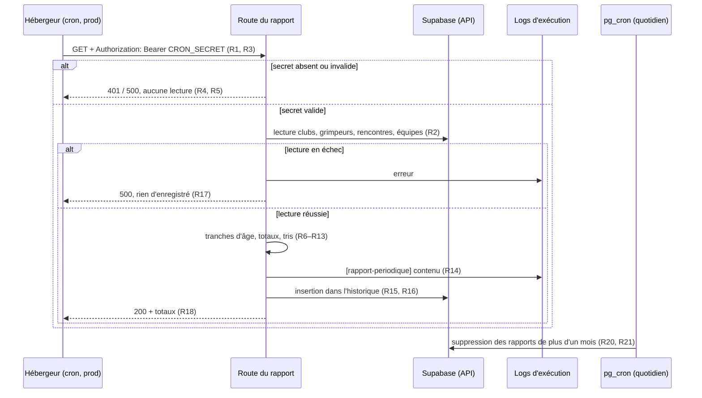

# Spec : Rapport périodique (et maintien d'activité de la base)

- **Statut** : validée (le 2026-10-16)
- **Sources** :
  - **Décision produit du 2026-10-16** : un traitement planifié produit **tous
    les 3 jours** un rapport : **nombre de clubs**, **nombre de grimpeurs**
    répartis entre enfant et ado (détail **par club**), **rencontres de la
    saison**. Base visée : **prod**. Seul l'admin (julleroyfr) le consulte.
  - **Décisions de cadrage (2026-10-16)** :
    - les grimpeurs de l'**âge pivot** (13 ans) forment une **tranche séparée**
      (ni enfant, ni ado) pour que le total soit exact ;
    - le rapport est **tracé dans les logs** d'exécution **et** enregistré dans
      une table d'historique (les logs de l'offre gratuite Vercel ne sont
      conservés qu'environ une heure) ;
    - les rapports de **plus d'un mois** sont **purgés** par une tâche
      **pg_cron** ;
    - le déclenchement est **externe à la base** (cron de l'hébergeur appelant
      une route) : il sert aussi à **maintenir le projet Supabase actif**.
      L'offre gratuite met en pause un projet après 7 jours sans activité, et une
      tâche pg_cron interne ne compte pas comme une activité. Cela justifie
      l'écart au principe « pas d'API custom » (conventions).
  - **Spec #1 — Rôles** (`01-roles-et-autorisations.md`) : **R34** (âge rapporté
    à la saison, pivot 13 ans, ado jusqu'à 19 ans) et **R37** (saison calculée à
    partir de la date).
  - **ADR 0005** (`docs/decisions/0005-lecture-transverse-service-role.md`) :
    usage de `service_role` gardé ; cette spec y ajoute une **exception**
    (cf. R19).
- **Note de rédaction** : spec purement données/traitement, **sans écran** (pas
  de maquette). Elle ne modifie aucune règle existante.

## Objectif

Donner à l'admin, sans action de sa part, une **photographie régulière** de
l'activité de la saison : clubs, effectifs par tranche d'âge et rencontres. Le
même traitement **empêche la mise en pause** du projet Supabase gratuit, car il
sollicite la base au moins une fois par semaine.

## Vocabulaire

- **Rapport périodique** : photographie des clubs, des grimpeurs et des
  rencontres de la saison, produite à une date donnée.
- **Date d'exécution** : date (fuseau Europe/Paris) à laquelle le rapport est
  produit.
- **Saison courante** : saison (R37 de la spec #1) qui contient la date
  d'exécution.
- **Tranche d'âge** : classement d'un grimpeur selon son âge dans la saison
  courante, à savoir *enfant*, *pivot*, *ado* ou *hors tranche* (R7).
- **Déclencheur** : la tâche planifiée de l'hébergeur qui appelle la route du
  rapport.
- **Secret du déclencheur** : valeur partagée entre l'hébergeur et la route
  (variable `CRON_SECRET`), exigée à chaque appel.

## Règles fonctionnelles

### Déclenchement

- **R1.** Le rapport est produit **tous les 3 jours**, les jours 1, 4, 7, …, 28
  et 31 du mois, à **06:00 UTC**. Entre deux rapports, il y a au plus **3
  jours**. Après un 31, le rapport suivant arrive le 1er, soit **1 jour** plus
  tard.
- **R2.** Le déclencheur est **externe à la base** et lit les données par
  l'**API Supabase**. Chaque exécution compte donc comme une activité du projet.
- **R3.** Le déclencheur ne s'exécute que sur le **déploiement de production**.
  Les déploiements de prévisualisation (`develop`) ne déclenchent rien.
- **R4.** La route du rapport **refuse** (HTTP 401) tout appel qui ne porte pas
  l'en-tête `Authorization: Bearer <CRON_SECRET>`. Un appel refusé ne lit et
  n'écrit **aucune donnée**.
- **R5.** Si `CRON_SECRET` n'est **pas configuré** côté serveur, la route
  **refuse tout appel** (HTTP 500), sans rien lire ni écrire.

### Contenu du rapport

- **R6.** Le rapport indique sa **date d'exécution** et la **saison courante**
  (libellé « AAAA–AAAA+1 »).
- **R7.** La tranche d'âge d'un grimpeur se calcule à partir de son **âge en
  saison** (année de la saison courante moins année de naissance, spec #1 R34) :
  - **enfant** : âge ≤ 12 ;
  - **pivot** : âge = 13 ;
  - **ado** : 14 ≤ âge ≤ 19 ;
  - **hors tranche** : âge ≥ 20.

  Chaque grimpeur appartient à **exactement une** tranche.
  *(Catégorie adulte, rév. 2026-10-23 : la tranche « hors tranche » est renommée
  **« adulte »** — spec #20 R33.)*
- **R8.** Le rapport donne le **nombre total de clubs**.
- **R9.** Pour **chaque club**, le rapport donne son **nom** et le nombre de
  grimpeurs **par tranche** (enfant, pivot, ado, hors tranche) ainsi que leur
  **total**. Les clubs sont triés par **nom** (ordre alphabétique, insensible à
  la casse et aux accents). Un club sans grimpeur figure avec des **0**.
- **R10.** Le rapport donne les **totaux tous clubs** par tranche et le **total
  général** des grimpeurs. Le total général est égal à la somme des totaux des
  clubs.
- **R11.** Le rapport liste les **rencontres de la saison courante** (date
  comprise entre le 1er septembre et le 31 août inclus, R37). Pour chacune, il
  donne la **date**, le **club porteur**, la **catégorie**, la **phase** et le
  **nombre d'équipes engagées**.
- **R12.** Les rencontres sont triées par **date croissante**, puis par
  **catégorie** (enfant avant ado).
- **R13.** Le rapport donne le **nombre de rencontres de la saison** par
  catégorie (enfant, ado) et au **total**.

### Diffusion et historique

- **R14.** Chaque rapport produit est **écrit dans les logs** d'exécution, sur
  une ligne préfixée par `[rapport-periodique]` et suivie de son contenu complet.
- **R15.** Chaque rapport produit est **enregistré** dans la table d'historique
  avec son **horodatage**, sa **saison** et son **contenu complet**.
- **R16.** Chaque exécution réussie enregistre **un nouveau** rapport. Il n'y a
  pas de dédoublonnage : un déclenchement manuel ajoute un rapport de plus.
- **R17.** Si la lecture des données échoue, l'erreur est écrite dans les logs,
  la route répond HTTP 500 et **aucun rapport n'est enregistré**.
- **R18.** En cas de succès, la route répond HTTP 200 avec les **totaux** (clubs,
  grimpeurs par tranche, rencontres).

### Accès et rétention

- **R19.** La table d'historique n'est **ni lisible ni modifiable** par les rôles
  de l'application (`anon`, `authenticated`). Seul le traitement l'alimente, via
  `service_role`. C'est une **exception à l'ADR 0005** : il n'y a pas de session
  utilisateur, et la garde est le secret du déclencheur (R4). L'admin consulte
  la table depuis le **Table Editor** de Supabase.
- **R20.** Une tâche **pg_cron** quotidienne (03:00 UTC) **supprime** les
  rapports dont l'horodatage date de **plus d'un mois**.
- **R21.** La purge ne supprime **que** des lignes de la table d'historique.

## Déroulement

## Scénarios

### Nominal

- **Étant donné** la prod avec 3 clubs, dont un sans grimpeur, et la date
  d'exécution 2026-10-16 (saison 2026–2027),
  **quand** le déclencheur appelle la route avec le bon secret,
  **alors** la route répond 200, les logs contiennent une ligne
  `[rapport-periodique]` avec 3 clubs triés par nom (le club vide à 0), et une
  ligne est ajoutée à l'historique avec la saison 2026.
- **Étant donné** un grimpeur né en 2013 et la saison 2026,
  **alors** il est compté en **pivot** (âge 13). Né en 2014, il est
  **enfant** (12). Né en 2012, il est **ado** (14). Né en 2006, il est
  **hors tranche** (20).
- **Étant donné** des rencontres le 2026-08-31, le 2026-09-01 et le 2027-08-31,
  **quand** le rapport est produit le 2026-10-16,
  **alors** seules les deux dernières figurent dans le rapport (saison 2026).

### Cas limites / erreurs

- Appel sans en-tête, ou avec un mauvais secret : 401, rien n'est lu ni
  enregistré (R4).
- `CRON_SECRET` absent de l'environnement : 500, rien n'est lu ni enregistré
  (R5).
- Base vide (aucun club) : rapport à 0 club, 0 grimpeur, 0 rencontre, enregistré
  normalement.
- Rencontre sans équipe engagée : listée avec 0 équipe.
- Déclenchement manuel (bouton « Run » de l'hébergeur) : un rapport de plus est
  enregistré (R16).
- Rapport enregistré il y a 31 jours : supprimé par la purge suivante (R20).

## Contraintes de données

- Nouvelle table `interclub.rapport_periodique` :
  - `id` (uuid, clé primaire) ;
  - `cree_le` (timestamptz, non nul, `now()` par défaut, indexé pour la purge) ;
  - `saison` (int, non nul : année de début de la saison) ;
  - `contenu` (jsonb, non nul).
- RLS **activée** et **aucune policy** pour `anon` / `authenticated` (R19).
- Extension **pg_cron** activée. La tâche de purge est **nommée**, et la créer
  une deuxième fois remplace la première (migration rejouable).
- Migration appliquée **à la main** (recette puis prod), consignée dans
  `supabase/migrations/JOURNAL.md`.

## Configuration

- Variable `CRON_SECRET` à définir dans l'environnement **Production** de
  l'hébergeur (16 caractères aléatoires au moins).
- `SUPABASE_SERVICE_ROLE_KEY` est déjà présente.

## Hors périmètre

- Envoi du rapport par mail ou par messagerie.
- Écran de consultation dans l'application.
- Maintien d'activité de la base de **recette** : les déploiements de
  prévisualisation ne déclenchent pas le cron (R3).
- Répartition des effectifs par sexe, par équipe ou par rencontre.
- Bascule vers un autre hébergeur (Netlify Scheduled Function) : la route et le
  domaine resteraient réutilisables, seule la déclaration du cron changerait.
