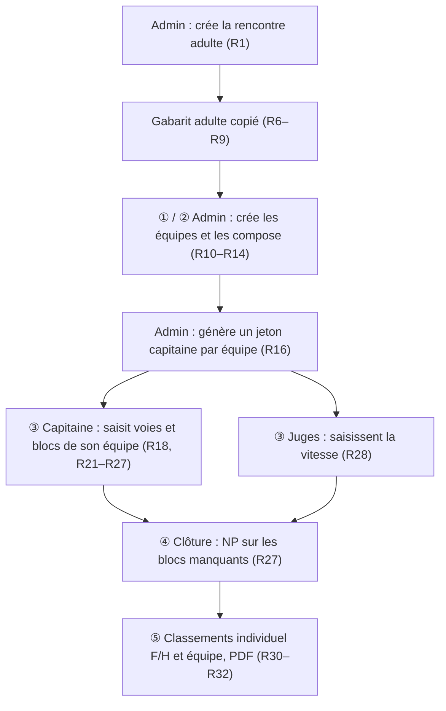
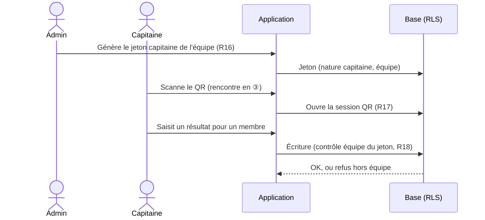

# Spec : Catégorie adulte

- **Statut** : validée (2026-10-23)
- **Sources** :
  - **Règlement** : *Règlement des interclubs d'escalade — Addendum règlement
    Adultes*, CT 33 FFME 2025-2026 (`docs/reglement/2025 Interclubs - Reglement
    v3_1 - Adultes (2).pdf`). L'addendum **complète** le règlement jeunes
    (`docs/reglement/2025 Interclubs - Reglement v3 (2).pdf`) : ce qui n'y est pas
    redéfini reste celui de la catégorie 13/19 ans (ado).
  - **Décisions produit du 2026-10-23** :
    - catégorie **adulte** ouverte dès **16 ans** en saison (la catégorie U18 de
      l'addendum désigne les plus de 16 ans), sans borne haute ;
    - **import** des licenciés **sans limite d'âge** ;
    - **pas de classement club** en adulte ;
    - l'**admin** crée et compose les équipes (clubs mélangés, 4 au plus) et
      délivre un **jeton QR capitaine** par équipe ;
    - saisie des voies et des blocs par l'**admin** et le **capitaine** ;
    - **plafond de 6 voies**, comme en ado ;
    - barème de vitesse de l'addendum lu par **tranches de 5 rangs** (75, 60,
      45, 30, 15) ;
    - gabarit par défaut à **2 blocs** (variante « 2 blocs » de l'addendum),
      configurable ;
    - **réversibilité** : branche dédiée, migrations additives livrées avec un
      script de retour arrière (une seule base de recette).
  - Specs **impactées** (renvois, cf. « Impacts sur les specs existantes ») :
    #1 R34, #2 R9b–R23, #3 R29–R33, #5 R13/R15, #6 R11/R12/R14, #7 R6,
    #13 R7, #15 R4, #19.

## Objectif

Faire tourner une **rencontre adulte** de bout en bout : création depuis un
gabarit adulte, composition d'équipes **inter-clubs** par l'admin, saisie des
voies et blocs par un **capitaine d'équipe** (session QR) ou par l'admin, vitesse
par les juges, puis classements individuel et par équipe. Le comportement des
catégories **enfant** et **ado** reste **inchangé**.

## Vocabulaire

- **Catégorie adulte** : troisième catégorie de rencontre (`adulte`), à côté de
  `enfant` et `ado` (spec #1 R34).
- **Équipe adulte** : équipe d'une rencontre adulte, **sans club porteur**,
  créée et composée par l'admin ; ses membres peuvent venir de clubs différents.
- **Capitaine** : personne qui saisit les résultats de voie et de bloc **d'une
  équipe adulte**, au moyen d'un **jeton QR capitaine** (session éphémère, spec
  #2).
- **Top en moulinette** : voie de difficulté réussie en entier, mais grimpée en
  moulinette (corde du haut) et non en tête.
- **Âge en saison** : année de la saison moins année de naissance (spec #1 R34,
  R37).

## Règles fonctionnelles

### Catégorie et éligibilité

- **R1.** Une rencontre peut porter la catégorie **adulte**, en plus des
  catégories enfant et ado (spec #1 R34). Son libellé est « Adulte ».
- **R2.** Un grimpeur est **éligible** à une rencontre adulte si et seulement si
  son **âge en saison** est **≥ 16**. Il n'y a pas d'âge maximal.
  *(Source : décision 2026-10-23.)*
- **R3.** Un grimpeur de 16 à 19 ans en saison est éligible à la fois à l'ado et à
  l'adulte : il peut être engagé dans une rencontre de chaque catégorie.
- **R4.** Les rencontres adultes suivent le même **cycle de phases** (① à ⑤) et
  les mêmes garde-fous de date que les autres catégories (spec #1 R5).

### Import des licenciés

- **R5.** L'import des licenciés FFME (spec #13) et l'import CSV sans licence
  (spec #18) importent les licenciés **de tout âge** : le filtre « 18 ans au
  plus » (spec #13 R7) est supprimé. L'éligibilité à une catégorie reste
  vérifiée à l'engagement (R2, spec #1 R34).

### Gabarit adulte

- **R6.** Il existe un **gabarit adulte**, copié dans chaque rencontre adulte à sa
  création, puis modifiable par l'admin, comme les autres gabarits (spec #3
  R29–R32).
- **R7.** Le gabarit adulte comporte **10 voies de difficulté** T1 (4c) à T10
  (7c), **sans voie de moulinette dédiée** (pas de M1–M4). Leurs points sont ceux
  de l'addendum :

  | Voie | Cotation | Zone 1 | Zone 2 | Top (tête) |
  |------|----------|--------|--------|------------|
  | T1 | 4c | 1 | 2 | 4 |
  | T2 | 5a | 3 | 4 | 6 |
  | T3 | 5b | 5 | 6 | 8 |
  | T4 | 5c | 7 | 8 | 10 |
  | T5 | 6a | 9 | 10 | 12 |
  | T6 | 6b | 11 | 12 | 14 |
  | T7 | 6c | 13 | 14 | 16 |
  | T8 | 7a | 15 | 16 | 18 |
  | T9 | 7b | 17 | 18 | 20 |
  | T10 | 7c | 19 | 20 | 22 |

- **R8.** Le gabarit adulte comporte **2 blocs** (variante « 2 blocs » de
  l'addendum) :
  - **B1** : paliers « Zone » **15** points, « Bloc complet » **30** points ;
  - **B2** : paliers « Zone 1 » **20**, « Zone 2 » **50**, « Bloc complet »
    **70** points.

  L'admin peut ajouter des blocs et modifier les paliers (spec #3 R31), par
  exemple pour la variante « 5 blocs » de l'addendum.
- **R9.** Le gabarit adulte comporte une épreuve de **vitesse** avec **2 voies**,
  libellées par défaut **« Voie 1 »** et **« Voie 2 »** (aucune mention de sexe),
  et ce **barème par rang** (spec #3 R46) :

  | Rangs | Points |
  |-------|--------|
  | 1 | 100 |
  | 2 | 95 |
  | 3 | 90 |
  | 4 | 85 |
  | 5 | 80 |
  | 6 à 10 | 75 |
  | 11 à 15 | 60 |
  | 16 à 20 | 45 |
  | 21 à 25 | 30 |
  | 26 à 30 | 15 |
  | 31 et au-delà | 10 |
  | Chute | 5 |
  | Non-présentation | 0 |

- **R9bis.** L'admin peut **modifier le libellé** d'une voie de vitesse existante,
  dans un gabarit comme dans une rencontre (par exemple « Voie 1 — dalle »). Le
  libellé est obligatoire et normalisé (spec #3 R4) ; une saisie vide est refusée
  et l'ancien libellé est conservé. Le nouveau libellé s'affiche partout où la
  voie apparaît (jetons QR, écran juge, saisie). Cette possibilité vaut pour
  **toutes les catégories** (renvoi dans spec #3 R32). *(Décision 2026-10-23.)*

### Équipes adultes

- **R10.** Dans une rencontre adulte, **seul l'admin** crée, renomme, supprime et
  compose les équipes, en phases ① pré-compétition et ② préparation. Le coach
  (permanent ou temporaire) n'a **aucun droit d'écriture** sur les équipes d'une
  rencontre adulte. *(Remplace, en adulte, spec #5 R13/R16.)*
- **R11.** Une équipe adulte n'est rattachée à **aucun club**. L'admin y compose
  des grimpeurs **éligibles** (R2) de **n'importe quel club**, sans passer par un
  prêt (spec #1 R35/R36 sans objet en adulte).
- **R12.** Une équipe adulte compte **au plus 4** grimpeurs. Un 5ᵉ ajout est
  refusé. *(Source : addendum §4 ; remplace, en adulte, spec #5 R15.)*
- **R13.** Un grimpeur est composé dans **au plus une** équipe d'une même
  rencontre adulte (même règle qu'en enfant et ado, spec #5 R14).
- **R14.** Le nom d'une équipe adulte est **obligatoire** et normalisé comme les
  autres (spec #5 R4/R10). Le nom proposé par défaut est « Équipe N » (N = plus
  grand numéro existant + 1).
- **R15.** La mixité des équipes et le mélange des clubs sont **recommandés**
  par l'addendum mais **non contrôlés** : aucune composition n'est refusée pour
  ces motifs.

### Capitaine d'équipe (jeton QR)

- **R16.** L'admin peut générer, afficher, révoquer et régénérer un **jeton QR
  capitaine** pour **chaque équipe** d'une rencontre adulte. Il y a **au plus un**
  jeton capitaine actif par équipe. *(Règles générales des jetons : spec #2
  R20–R23.)*
- **R17.** Une session ouverte avec un jeton capitaine n'est valide qu'en **③
  compétition**. Elle prend fin dès la sortie de la ③, à la révocation du jeton
  ou à sa régénération (spec #2 R12/R13/R22).
- **R18.** Une session capitaine permet **uniquement** de saisir, modifier et
  retirer les résultats de **voie** et de **bloc** des **grimpeurs de son
  équipe**, dans la rencontre du jeton. Toute écriture sur un autre grimpeur,
  une autre équipe, la vitesse ou la composition est **refusée**.
- **R19.** La session capitaine **consulte** les résultats et le score des
  grimpeurs de son équipe, ainsi que le classement de la rencontre (lecture dès
  la ③, spec #7 R11).
- **R20.** Un jeton capitaine ne peut pas être généré pour une équipe d'une
  rencontre **enfant ou ado**. Les jetons « coach temporaire » d'une rencontre
  adulte ne sont pas proposés (R10).

### Saisie des résultats de voie et de bloc

- **R21.** Les résultats de voie et de bloc d'une rencontre adulte sont saisis
  par le **capitaine** de l'équipe du grimpeur (R18) ou par l'**admin** (spec #9),
  aux mêmes phases que la saisie coach (③ compétition, spec #6 R5).
- **R22.** Comme en ado, chaque grimpeur choisit **librement** ses voies, une voie
  ne porte qu'**un résultat** par grimpeur, deux voies distinctes de même niveau
  sont permises, et le nombre de voies est **plafonné à 6** (une 7ᵉ est refusée,
  correction d'une voie déjà saisie permise). *(Source : addendum ; spec #6
  R11/R13/R14.)*
- **R23.** Les issues admises pour une voie adulte sont : **Top**, **Top en
  moulinette**, **Zone 2**, **Zone 1**, **Échec**. « NP » n'est pas saisissable
  (spec #6 R18).
- **R24.** Une voie en **Top** (tête) rapporte les points « Top » de la voie ;
  **Zone 2** et **Zone 1** rapportent les points de zone de la voie (non
  cumulatifs, comme en ado).
- **R25.** Un **Top en moulinette** rapporte **la moitié** des points « Top » de la
  voie, **arrondie à l'entier supérieur** (barème de l'addendum : 2, 3, 4 … 11).
  Les zones ne sont **pas** comptées en moulinette : une voie grimpée en
  moulinette sans aller au top est un **Échec** (0 point).
  *(Source : addendum, « les voies réalisées en moulinette rapportent la moitié
  des points de la voie, les prises valorisées ne sont pas comptabilisées ».)*
- **R26.** Les issues **Top en moulinette** et **Zone 1 / Zone 2** des voies sont
  réservées aux rencontres où elles sont prévues : Top en moulinette = adulte
  seulement ; zones = ado et adulte. Une issue non admise pour la catégorie est
  refusée, à la saisie comme en base.
- **R27.** Les blocs adultes se saisissent comme en ado : meilleur palier atteint
  ou échec, sans cumul (spec #6 R15–R17). À la clôture, les blocs sans résultat
  passent en **NP** ; les voies adultes, choisies librement, n'ont pas de NP
  (spec #6 R18).
- **R28.** La vitesse adulte est saisie par les **juges** comme dans les autres
  catégories (spec #10) ; les points suivent le barème de la rencontre (R9),
  classement séparé par sexe.

### Classements et exports

- **R29.** Le **score individuel** d'un grimpeur adulte est la somme de ses points
  de voies (R24/R25), de blocs et de vitesse (spec #7 R3).
- **R30.** Une rencontre adulte affiche le **classement individuel séparé par
  sexe** (spec #7 R8b) et le **classement par équipe** (somme des scores des
  membres, spec #7 R5). Elle n'a **pas de classement club** : ni à l'écran, ni sur
  l'écran secondaire, ni dans l'export PDF. *(Remplace, en adulte, spec #7 R6.)*
- **R31.** Au classement individuel, chaque grimpeur adulte est présenté avec son
  **club d'origine** (spec #7 R7). Au classement par équipe, une équipe adulte est
  présentée par son **nom seul**.
- **R32.** L'export PDF d'une rencontre adulte (spec #15) est accessible à
  l'admin, et au coach permanent **dont au moins un grimpeur** est composé dans
  une équipe de la rencontre. *(Remplace, en adulte, « au moins une équipe du
  club », spec #15 R4.)*
- **R33.** Dans le rapport périodique (spec #19) :
  - la tranche « hors tranche » (âge en saison ≥ 20) est renommée
    **« adulte »** ; les bornes des tranches ne changent pas (R7/R9) ;
  - les rencontres sont triées par date puis par catégorie **enfant, ado,
    adulte** (R12) ;
  - le nombre de rencontres de la saison est donné pour **enfant, ado,
    adulte** et au total (R13).

### Réversibilité

- **R34.** Chaque migration de la catégorie adulte est **additive** : appliquée,
  elle ne change **aucun** comportement des catégories enfant et ado, et le code
  de la branche `develop` continue de fonctionner sur la base.
- **R35.** Chaque migration de la catégorie adulte est livrée avec un **script de
  retour arrière** (dossier `supabase/retours-arriere/`). Son exécution :
  - supprime les données propres à l'adulte (rencontres adultes et tout ce qui en
    dépend, gabarit adulte, jetons capitaine) ;
  - restaure **à l'identique** les fonctions, triggers, contraintes et policies
    modifiés ;
  - laisse une base sur laquelle `db:verifier` et les suites SQL existantes
    passent.

## Scénarios

### Nominal

- Étant donné une rencontre adulte en ① et des grimpeurs de 17, 25 et 40 ans de
  trois clubs, quand l'admin crée « Équipe 1 » et y compose ces trois grimpeurs,
  alors l'équipe est enregistrée sans club (R11).
- Étant donné une rencontre adulte en ③ et la session capitaine d'« Équipe 1 »,
  quand le capitaine enregistre « Top en moulinette » sur la T5 (top 12) pour un
  membre, alors le grimpeur marque **6** points sur cette voie (R25).
- Étant donné un grimpeur avec un top en tête sur la T3 (8), une zone 2 sur la T6
  (12) et un top en moulinette sur la T4 (5), quand on calcule son score de voies,
  alors il vaut **25** (R24/R25).

### Cas limites / erreurs

- Ajout d'un grimpeur de 15 ans en saison à une équipe adulte → refusé (R2).
- Ajout d'un 5ᵉ grimpeur à une équipe adulte → refusé (R12).
- Un coach permanent tente de créer une équipe dans une rencontre adulte →
  refusé, à l'écran comme en base (R10).
- Le capitaine saisit un résultat pour un grimpeur d'une autre équipe → refusé
  (R18).
- Le capitaine tente de saisir un temps de vitesse → refusé (R18).
- Le jeton capitaine est scanné en ② ou en ④ → aucune session ouverte (R17).
- 7ᵉ voie saisie pour un grimpeur adulte → refusée (R22).
- « Top en moulinette » envoyé sur une voie d'une rencontre ado → refusé (R26).
- Top en moulinette sur une voie dont le top vaut 7 (gabarit modifié) → 4 points
  (R25).
- Génération d'un jeton capitaine sur une rencontre ado → refusée (R20).
- Libellé de voie de vitesse vidé à la modification → refusé, l'ancien libellé
  est conservé (R9bis).
- Retour arrière exécuté sur la base de recette → plus aucune rencontre adulte,
  les écrans enfant et ado fonctionnent comme avant (R35).

## Contraintes de données

- `rencontre.categorie` et la catégorie du gabarit acceptent `adulte` (R1, R6).
- Une équipe d'une rencontre adulte a un club **vide** ; une équipe d'une
  rencontre enfant ou ado a **toujours** un club (R11, inchangé hors adulte).
- La base refuse un 5ᵉ membre dans une équipe adulte (R12) et une 7ᵉ voie par
  grimpeur adulte (R22).
- La base refuse l'issue « Top en moulinette » hors catégorie adulte (R26).
- Écritures d'équipe et de composition d'une rencontre adulte : **admin
  seulement**, garanti par la RLS (R10).
- Un jeton QR de nature **capitaine** référence **une équipe** d'une rencontre
  adulte ; au plus un jeton capitaine actif par équipe (R16, R20).
- RLS : une session capitaine n'écrit que les résultats de voie et de bloc des
  membres de son équipe, en ③ (R17/R18) ; elle ne lit que ce que lit tout acteur
  identifié dès la ③ (spec #1, spec #7 R11).
- Réversibilité R34/R35 : les ajouts passent par de nouvelles policies (les
  policies Postgres s'additionnent), de nouvelles valeurs de contraintes et des
  colonnes nullables ; toute fonction existante modifiée est sauvegardée dans le
  script de retour arrière.

## Impacts sur les specs existantes

Chaque spec reçoit un **renvoi** vers la présente spec, sans réécrire ses règles
enfant/ado :

| Spec | Règle | Renvoi |
|------|-------|--------|
| #1 | R34 | 3ᵉ catégorie adulte, éligibilité ≥ 16 ans (R1–R3) ; prêts sans objet en adulte (R11) |
| #2 | R9b–R23 | nouvelle nature de jeton **capitaine** (R16–R20) |
| #3 | R29, R32, R33 | gabarit adulte (R6–R9) ; libellé de voie de vitesse modifiable (R9bis) |
| #5 | R13, R15, R16 | en adulte : équipes admin, sans club, 4 au plus (R10–R14) |
| #6 | R11, R12, R14 | issues adultes dont Top en moulinette, plafond 6 (R22–R27) |
| #7 | R6 | pas de classement club en adulte (R30/R31) |
| #13 | R7 | import sans limite d'âge (R5) |
| #15 | R4 | accès coach en adulte (R32) |
| #19 | R7, R12, R13 | tranche « adulte », tri et décompte des rencontres adultes (R33) |

## Hors périmètre

- Format **DUEL** de la vitesse (addendum) : non géré, la vitesse reste au temps.
- **Juges de bloc** : non prévus, les blocs sont saisis par le capitaine ou
  l'admin.
- Participation financière, horaires, assurage : organisation hors application.
- Classement **de saison** spécifique à l'adulte : les classements restent par
  rencontre.
- Contrôle de la mixité des équipes (R15).
