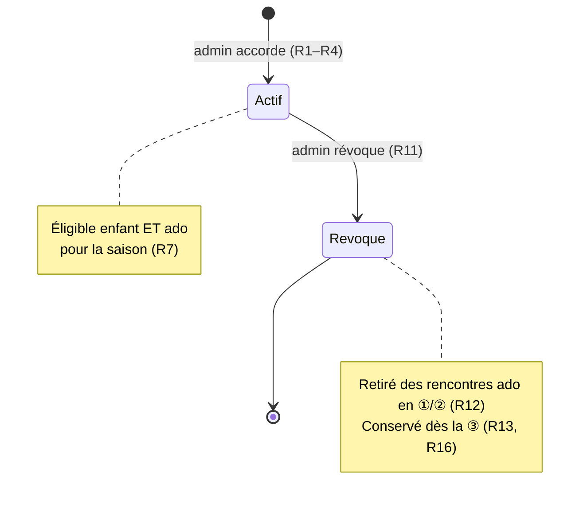
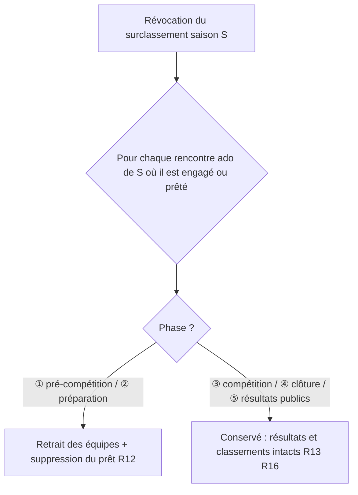

# Spec : Surclassement d'un grimpeur enfant en ado

- **Statut** : validée (2026-11-07)
- **Maquette** : [`docs/maquettes/surclassement.html`](../maquettes/surclassement.html)
- **Sources** :
  - **Règlement** : *Règlement des interclubs d'escalade 2026-2027*, CT 33 FFME
    (`docs/reglement/2027 Interclubs - Reglement v3.pdf`). Le règlement ne
    prévoit **pas** de surclassement : il fixe les tranches (matin « moins de
    13 ans », après-midi 13/19 ans, nés en 2014 dans les deux). Le surclassement
    est donc une **dérogation** décidée par l'organisation, au cas par cas.
  - **Décisions produit du 2026-11-07** :
    - un grimpeur **enfant** peut être **surclassé** pour concourir **aussi** en
      **ado** ; il reste enfant et peut faire les **deux** rencontres ;
    - **seul l'admin** accorde et révoque un surclassement ;
    - le surclassement vaut pour **une saison** et peut être **révoqué** ;
    - **tout enfant sous l'âge de bascule** peut être surclassé (le pivot est
      déjà éligible aux deux catégories) ;
    - à la **révocation**, le grimpeur est **retiré automatiquement** des équipes
      ado des rencontres en ① pré-compétition ou ② préparation ; dès la ③
      compétition, ses engagements et résultats sont **conservés** ;
    - un grimpeur révoqué **reste** dans les résultats et classements des
      rencontres ado où il a concouru ;
    - l'admin gère le surclassement sur l'**écran Grimpeurs** ; le coach voit un
      **badge** « surclassé ».
  - Specs **impactées** (cf. « Impacts sur les specs existantes ») : #1 R34,
    #3 R26 (écran Grimpeurs), #5 R12, #1 R35 (prêts).

## Objectif

Permettre à l'organisation d'aligner en **ado** un enfant dont le niveau le
justifie, sans le priver de sa rencontre **enfant**, pour **une saison**, et de
revenir sur cette décision à tout moment **sans effacer** ce qu'il a déjà
réalisé en ado.

## Vocabulaire

- **Âge en saison**, **âge de bascule B**, **âge maximum ado M** : cf. spec #1
  R34 et R34bis.
- **Surclassement** : autorisation, accordée par l'admin à un grimpeur pour une
  **saison** donnée (spec #1 R37), de concourir **en ado** en plus de l'**enfant**.
- **Surclassement actif** : surclassement accordé et **non révoqué**.
- **Révocation** : fin d'un surclassement actif, décidée par l'admin. La date de
  révocation est conservée.
- **Grimpeur surclassé** : grimpeur ayant un surclassement actif pour la saison
  de la rencontre considérée.

## Règles fonctionnelles

### Accord

- **R1.** Seul l'**admin** peut accorder ou révoquer un surclassement. Un coach
  (permanent ou temporaire), un juge ou un capitaine ne le peut pas, ni depuis
  l'interface ni directement en base.
- **R2.** Un surclassement porte sur **un grimpeur** et **une saison**. L'admin
  choisit la saison parmi la **saison courante** (spec #1 R37, calculée à la
  date du jour, proposée par défaut) et la **saison suivante**.
- **R3.** Un surclassement ne peut être accordé que si l'**âge en saison** du
  grimpeur, pour la saison choisie, est **strictement inférieur à B**. Sinon
  l'accord est refusé avec le message « Ce grimpeur est déjà éligible en ado
  pour cette saison » (âge ≥ B). Si B n'est pas configuré (spec #1 R34bis),
  l'accord est refusé avec le message de R34bis.
- **R4.** Un grimpeur a **au plus un** surclassement actif par saison. Accorder
  un surclassement à un grimpeur déjà surclassé pour cette saison est refusé
  (« Ce grimpeur est déjà surclassé pour cette saison »).
- **R5.** Un surclassement **ne se reporte pas** : il ne vaut que pour sa saison.
  Pour une autre saison, l'admin en accorde un nouveau.
- **R6.** Le surclassement est attaché au **grimpeur**, pas à son club : un
  changement de club (spec #3 R24) le conserve.

### Effet sur l'éligibilité

- **R7.** Un grimpeur surclassé pour la saison S est éligible à la catégorie
  **ado** pour **toutes** les rencontres ado de la saison S, en plus de son
  éligibilité **enfant**, qui reste inchangée (spec #1 R34). Il peut donc être
  engagé dans une rencontre enfant **et** dans une rencontre ado.
- **R8.** Le surclassement n'ouvre **aucune** autre catégorie : un grimpeur
  surclassé n'est **pas** éligible à l'**adulte** (spec #20 R2).
- **R9.** L'éligibilité étendue (R7) vaut partout où l'éligibilité ado est
  vérifiée : composition d'équipe par le coach (spec #5 R12), engagement et
  prêt par l'admin (spec #1 R35, spec #3 tableau de bord). Un grimpeur surclassé
  peut être **prêté** à un autre club ou à l'équipe CT33 pour une rencontre ado.
- **R10.** Dans une rencontre ado, un grimpeur surclassé concourt **comme un
  ado** : mêmes épreuves, plafond de 6 voies (spec #6 R14), barème de vitesse
  ado de son sexe (spec #10), pas de groupe de départ (spec #5).

### Révocation

- **R11.** L'admin peut révoquer un surclassement actif à tout moment. La
  révocation conserve la **trace** du surclassement (date d'accord, date de
  révocation). Après révocation, l'admin peut **accorder à nouveau** un
  surclassement pour la même saison (R3–R4 s'appliquent) ; c'est un nouvel
  accord, l'ancien reste dans l'historique.
- **R12.** À la révocation d'un surclassement de la saison S, le grimpeur, s'il
  n'est pas éligible ado par son âge, est **retiré** de toute équipe d'une
  rencontre **ado** de la saison S en phase **① pré-compétition** ou **②
  préparation** ; son éventuel **prêt** sur ces mêmes rencontres est **supprimé**.
  Les données liées à ces engagements sont purgées comme pour tout retrait
  (spec #10 R18).
- **R13.** La révocation ne touche **aucune** rencontre ado en phase **③
  compétition**, **④ clôture** ou **⑤ résultats publics** : compositions, prêts,
  résultats de voie et de bloc et résultats de vitesse sont **conservés**
  tels quels.
- **R14.** Retrait (R12), conservation (R13) et fin du surclassement sont
  **indivisibles** : soit tout est appliqué, soit rien (aucun état
  intermédiaire en cas d'erreur).
- **R15.** Avant de révoquer, l'admin voit une **confirmation** qui liste les
  rencontres ado (date, club organisateur, équipe) dont le grimpeur sera
  retiré (R12), ou indique « Aucun engagement ado à venir » s'il n'y en a pas.
  Après révocation, le message de succès rappelle le nombre de retraits.

### Résultats et classements

- **R16.** Les résultats, classements (spec #7), exports PDF (spec #15) et
  écrans de contrôle (spec #16) d'une rencontre **ne réexaminent jamais**
  l'éligibilité : un grimpeur engagé dans une rencontre y apparaît, avec ses
  résultats et ses points (individuel, équipe, club), **même si** son
  surclassement a été révoqué depuis.
- **R17.** Un grimpeur dont le surclassement est révoqué, mais qui reste engagé
  dans une rencontre ado en ③ ou ④ (R13), peut encore y voir ses résultats
  **saisis ou corrigés** selon les droits habituels (spec #6, spec #9).

### Affichage

- **R18.** Sur l'écran **Grimpeurs** de l'admin, chaque grimpeur surclassé pour
  la saison courante porte un badge **« Surclassé ado »**. Chaque grimpeur
  d'âge en saison **inférieur à B** (saison courante ou suivante) propose
  l'action **« Surclasser »** ; un grimpeur surclassé propose **« Révoquer le
  surclassement »**.
- **R19.** L'admin voit, pour un grimpeur, l'**historique** de ses surclassements
  (saison, date d'accord, date de révocation s'il y a lieu).
- **R20.** Côté **coach**, un grimpeur surclassé pour la saison de la rencontre
  porte le badge **« Surclassé »** dans la liste d'ajout d'une rencontre ado et
  dans la composition des équipes ado. Le coach n'a aucune action sur le
  surclassement (R1).
- **R21.** Un grimpeur dont le surclassement a été révoqué n'apparaît plus dans
  la liste d'ajout d'une rencontre ado (il n'est plus éligible). Dans une
  rencontre en ③ ou après où il reste engagé (R13), il apparaît **sans** badge.

## Diagramme — cycle de vie d'un surclassement

## Scénarios

### Nominal — surclasser puis engager dans les deux rencontres

- **Étant donné** la saison 2026, B = 12, une grimpeuse née en 2015 (11 ans),
  **quand** l'admin la surclasse pour la saison 2026, **alors** elle porte le
  badge « Surclassé ado » (R18), et le coach de son club peut l'ajouter à une
  équipe de la rencontre enfant du 2026-11-21 matin **et** à une équipe de la
  rencontre ado du même jour après-midi (R7), où elle porte le badge
  « Surclassé » (R20).

### Nominal — révocation après une rencontre ado disputée

- **Étant donné** un grimpeur surclassé pour 2026, engagé dans la rencontre ado
  A (⑤ résultats publics, où il a marqué des points) et dans la rencontre ado B
  (① pré-compétition), **quand** l'admin révoque le surclassement, **alors** la
  confirmation annonce le retrait de la rencontre B (R15), il est retiré de son
  équipe en B (R12), et il apparaît toujours dans les résultats et classements
  de A avec ses points (R13, R16).

### Nominal — révocation pendant une rencontre en cours

- **Étant donné** un grimpeur surclassé engagé dans une rencontre ado en ③
  compétition, **quand** l'admin révoque, **alors** il reste engagé et ses
  résultats restent saisissables par le coach (R13, R17).

### Cas limites / erreurs

- Surclasser un grimpeur né en 2014 (pivot, 12 ans en 2026) → refusé, déjà
  éligible ado (R3).
- Surclasser un grimpeur de 13 ans ou plus → refusé (R3).
- Surclasser un grimpeur déjà surclassé pour la saison → refusé (R4).
- `AGE_BASCULE` absente → accord refusé avec le message de R34bis (R3).
- Un coach tente d'insérer un surclassement en base → refusé par la RLS (R1).
- Surclassement de la saison 2026 : il ne rend pas éligible aux rencontres ado
  de la saison 2027 (R5).
- Révoquer puis surclasser à nouveau → nouvel accord, l'historique montre les
  deux (R11, R19).
- Un grimpeur surclassé prêté à un autre club sur une rencontre ado en ① puis
  révoqué → prêt supprimé et retrait de l'équipe d'accueil (R12).
- Erreur pendant la révocation → aucun retrait appliqué et surclassement
  toujours actif (R14).
- Grimpeur surclassé : pas éligible à une rencontre adulte (R8).

## Contraintes de données

- Table `surclassement` : `id`, `grimpeur_id` (→ `grimpeur`, suppression en
  cascade), `saison` (entier, année de début de saison, spec #1 R37),
  `accorde_le`, `revoque_le` (nul tant que le surclassement est actif).
- **Unicité** : au plus une ligne active (`revoque_le` nul) par
  (`grimpeur_id`, `saison`) (R4) ; `revoque_le` ≥ `accorde_le`.
- **RLS attendue** :
  - écriture (insertion, révocation) : **admin** seul (R1) ;
  - lecture : admin ; coach du club du grimpeur ; coach du club d'accueil d'un
    grimpeur prêté (comme la lecture de `grimpeur`, spec #1 R35/R36) ;
    aucune lecture pour un acteur non identifié (spec #1 R8).
- La révocation (R12–R14) est une opération **atomique** en base, réservée à
  l'admin.
- L'éligibilité reste contrôlée à l'**engagement** (spec #1 R34) ; aucune
  contrainte ne réexamine les compositions existantes (R16).

## Impacts sur les specs existantes

| Spec | Règle | Changement |
|------|-------|------------|
| #1 | R34 | Éligibilité ado = tranche d'âge **ou** surclassement actif de la saison (renvoi R7–R8) |
| #1 | R35 | Prêt ado possible pour un surclassé ; prêt supprimé à la révocation en ①/② (R9, R12) |
| #3 | R26 | Écran Grimpeurs : badge, actions Surclasser / Révoquer, historique (R18–R19) |
| #5 | R12 | Liste d'ajout ado : surclassés inclus, badge « Surclassé » (R7, R20–R21) |

## Hors périmètre

- Tout surclassement autre qu'enfant → ado (ado → adulte, sous-classement).
- Une décision de surclassement par **rencontre** (le surclassement vaut pour
  toute la saison).
- Le rapport périodique (spec #19) : ses tranches restent calculées sur l'âge.
- Toute notification au coach ou au club lors d'un accord ou d'une révocation.
- Le classement cumulé de saison (spec #7, hors périmètre).
